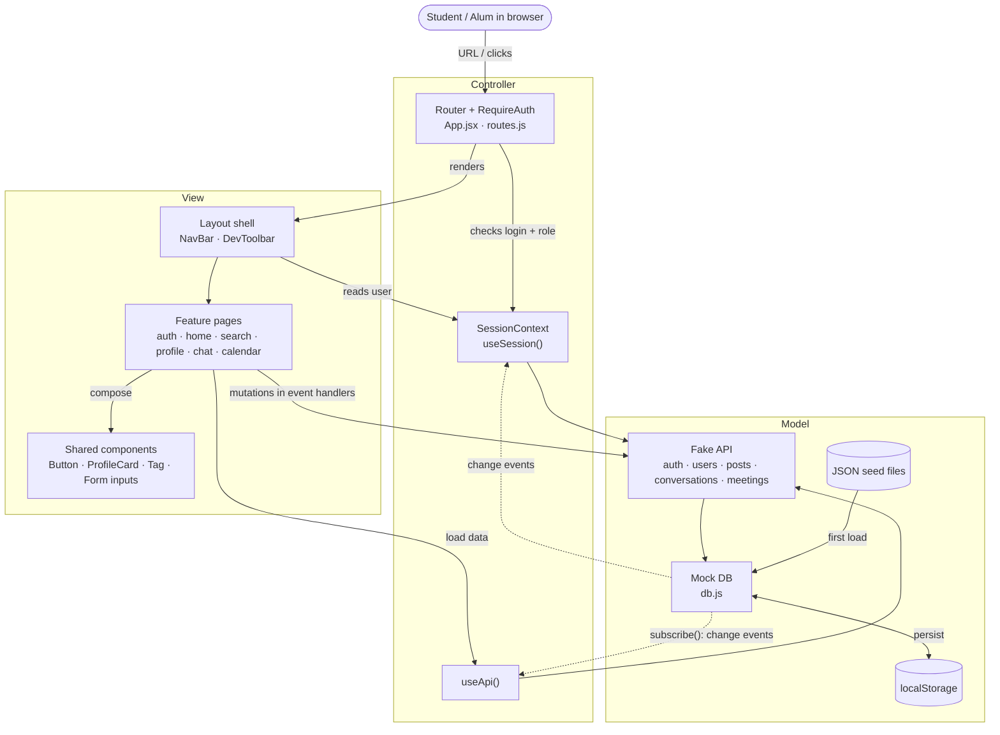
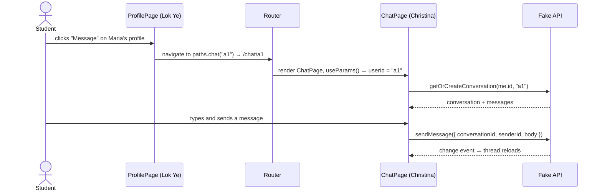

# Architecture Overview

Northeastern Alumni Connection is a web app that connects Northeastern students with alumni for referrals, advice, and coffee chats. This document describes how the system is put together, so the team shares one vocabulary for the requirements that follow.

## 1. Platform and Technology Stack

| Layer | Choice | Why |
| ----- | ------ | --- |
| Platform | **Web browser** (desktop and mobile), served as a single-page app | Students and alumni already live in the browser (email, LinkedIn, job boards). Nothing to install, and it works on any laptop or phone. |
| Language | **JavaScript (ES2022) + JSX** | Everyone on the team knows JavaScript. We skipped TypeScript so that nobody is slowed down by learning a type system mid-project; JSDoc comments on the API give editor hints instead. |
| UI framework | **React 19** | Component-based, so shared pieces (profile cards, buttons, form inputs) are written once and reused across five people's pages. It has the largest ecosystem and the most learning material. |
| Routing | **React Router 7** | Gives each screen a real URL (`/profile/a1`, `/chat/a1`), so links, the back button, and bookmarks work, and pages can hand off to each other through the URL. |
| Build tool | **Vite** | Instant dev server with hot reload, and one-command production builds. |
| Styling | **Plain CSS + CSS custom properties** (design tokens) | No extra framework to learn. Tokens in `src/styles/tokens.css` keep colors and spacing consistent. |
| Data | **Fake API module + JSON seed files + `localStorage`** | Lets us build and demo the full interface without writing a server (see Decision 1). |
| Quality | **oxlint** (linting), **Prettier** (formatting), GitHub pull requests | Keeps five people's code consistent and reviewable. |

## 2. Major Components

The app follows a layered Model–View–Controller structure. React merges View and Controller inside components, so we keep them apart by *where code lives*.

| Component | Location | MVC role | Responsibility |
| --------- | -------- | -------- | -------------- |
| **Seed data** | `src/data/*.json` | Model (storage) | Starting data: students, alumni, posts, conversations, availability slots, meetings. |
| **Fake API** | `src/api/` | Model (logic) | The only way to read or change data. Async functions (`getAlumni()`, `sendMessage()`, `createMeeting()`…) that validate input, enforce rules (only alumni can post, a slot can't be double-booked), and throw `ApiError` on failure, the way a real backend would. One file per domain: `auth`, `users`, `posts`, `conversations`, `meetings`. |
| **Mock database** | `src/api/db.js` | Model (persistence) | Loads the seed data, saves changes to `localStorage`, and notifies subscribers when data changes. Re-seeds automatically when a JSON file is edited. |
| **Session** | `src/context/SessionContext.jsx` | Controller (app state) | Tracks who is logged in and whether they are a student or an alum. Exposes `useSession()` with `login`, `logout`, `signup`, `isStudent`, `isAlumni`. |
| **Data hook** | `src/hooks/useApi.js` | Controller | Calls the API and manages `loading` / `error` / `data` state for a page. Can reload automatically when data changes (for chat and calendar). |
| **Router + guards** | `src/App.jsx`, `src/routes.js`, `RequireAuth` | Controller (navigation) | Maps URLs to pages. Guards redirect users who are logged out, unverified, not onboarded, or the wrong role. `routes.js` is the single source of truth for every path. |
| **Layout shell** | `src/components/Layout`, `NavBar`, `DevToolbar` | View | The parts on every page: skip link, role-aware nav bar, and main content area. The dev toolbar (dev builds only) switches users and resets data for testing. |
| **Shared components** | `src/components/` | View | Reusable building blocks: `Button`, `ProfileCard`, `Tag`, `Avatar`, `Card`, `PageHeader`, form inputs (`TextField`, `Select`, `TagInput`, `FileInput`…), and loading/error/empty states. All are shown live at `/styleguide`. |
| **Feature pages** | `src/pages/<area>/` | View + local Controller | One folder per team member: `auth` (sign up, verify, onboarding), `home` + `landing` (feeds, posts), `search` + `profile`, `chat` + `calendar`. Pages compose shared components and call the API through `useApi` and event handlers. |

## 3. Component Relationships

**How the pieces talk to each other:**

- **Data flows one way.** Pages never import JSON or touch `localStorage`. They call the API, and the API is the only code that touches the database. Swapping in a real backend later would mean rewriting `src/api/` only.
- **Change notifications keep screens in sync.** After every write, the database notifies subscribers. That's how the nav bar updates after a profile edit, and how a chat thread refreshes after a message is sent.
- **Pages hand off through URLs, not shared state.** For example:

**Extension points** (where new work plugs in):

| To add… | Do this |
| ------- | ------- |
| A new page | Create it in your `src/pages/<area>/` folder, add its path to `routes.js`, and add a `<Route>` in `App.jsx` inside the right guard (any user, student-only, alumni-only). |
| A new data operation | Add an async function to the matching `src/api/<domain>.js` file, call `commit()` after any write, and re-export it from `src/api/index.js`. |
| A new kind of mock data | Add a JSON file in `src/data/`, register it in `buildSeed()` in `db.js`. |
| A new message type (beyond text and referral requests) | Add it to `MESSAGE_TYPES` in `constants.js`, add a send function in `conversations.js`, and render it in the chat thread. |
| A new shared UI piece | Add it under `src/components/`, export it from `components/index.js`, and show it on `/styleguide`. |
| A real backend | Replace the function bodies in `src/api/` with `fetch()` calls. Function names and return shapes stay the same, so no page has to change. |

## 4. Key Design Decisions

1. **Fake API in the browser instead of a real backend.** *Alternatives:* a Node/Express server, or Firebase. *Chose:* an async JavaScript module backed by JSON and `localStorage`. This is a GUI course, so effort should go into the interface, not servers, hosting, or auth security. Because the API is async and throws errors like a real one, the UI still handles loading and failure states honestly, and a real backend could replace it later without changing any page. *Trade-off:* data lives in each person's browser, so two users can't actually message each other across devices. The dev toolbar's user switcher simulates both sides on one machine.

2. **Single-page app with client-side routes instead of separate HTML pages.** The nav bar, login session, and shared components persist across screens without reloading, and URL parameters (`/chat/:userId`) give clean handoffs between teammates' pages. *Trade-off:* the host must send every URL to `index.html`. This is a one-line setting on Netlify, Vercel, or GitHub Pages.

3. **Hand-rolled components instead of a UI library** (Material UI, Bootstrap, Chakra). The app should look like Northeastern (red/black palette), and the course is about building interfaces, so we wanted to own the components and their accessibility (labels, focus states, ARIA attributes) rather than inherit a library's defaults. The set we need is small. *Trade-off:* more upfront work for Andrew. This is offset by the shared `/styleguide` page.

4. **Plain CSS with design tokens instead of Tailwind or CSS-in-JS.** Nothing extra for the team to learn, and the tokens (`--color-brand`, `--space-4`) still give one place to change the look.

5. **One folder per team member, plus a shared core.** Each person owns `src/pages/<area>/`, and only Andrew routinely edits shared files (`api/`, `components/`, `App.jsx`). This keeps merge conflicts rare and makes ownership obvious during review.

6. **Centralized route guards.** Login, email-verification, onboarding, and role checks live in one `RequireAuth` component in the router, not in each page. This means no page can forget a check, and new users are always funneled through sign up → verify → onboarding.

7. **Mock email verification.** We require an `@northeastern.edu` address but accept a fixed code (`123456`) instead of sending real email. This exercises the full verification UI without an email service.

8. **All times stored as UTC ISO strings, formatted in the viewer's time zone.** Meetings appear at the correct local time for both student and alum.

## Where the code stands

The structure above already exists in the repository:

- The **Model** (`src/api`, `src/data`) and **Controller** layers (`SessionContext`, `useApi`, router and guards) are implemented, with JSDoc on every API function.
- The **shared View** components and layout shell are implemented.
- Each **feature page** exists as a routed placeholder with a TODO list of what it must contain and which API functions to call. Team members replace these with their real pages.

See [README.md](README.md) for setup, the ownership table, the full API reference, and data shapes.
